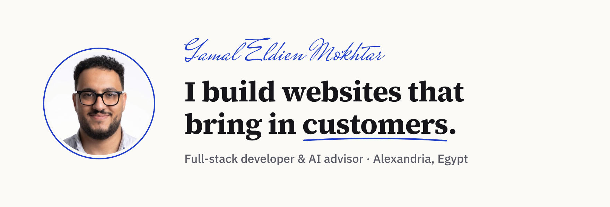

<picture>
  <source media="(prefers-color-scheme: dark)" srcset="./assets/banner-dark.png">
  
</picture>

  <a href="https://gamaleldiengamal.com"><b>gamaleldiengamal.com</b></a> &nbsp;·&nbsp;
  <a href="https://www.linkedin.com/in/gamaleldiengamal/">LinkedIn</a> &nbsp;·&nbsp;
  <a href="https://www.upwork.com/freelancers/gamaleldiengamal">Upwork (Top Rated)</a> &nbsp;·&nbsp;
  <a href="mailto:jaime077011@gmail.com">Email</a>

I build web apps, websites that bring in customers, and AI tools that save businesses time.\
5+ years of work for clients in Saudi Arabia, the Arab world, Europe and the US.

أبني مواقع تجلب العملاء، وأستخدم الذكاء الاصطناعي لأوفر وقتك.

## What I do

**Websites that sell.** Fast on mobile, a clear message, and an easy way to reach you on every page. WordPress, WooCommerce, Shopify, or custom builds in Next.js.

**Web apps.** From idea to a working product, front end to database. Next.js, React, TypeScript, Laravel, Django, Supabase.

**AI that saves time.** I find the tasks that eat up a business's day and hand them to AI: WhatsApp replies, bookings, follow-ups.

## Full-stack projects

### [Coachi](https://thecoachiapp.com)
A web app for fitness coaches. Coaches build workout and nutrition plans, manage clients, and follow each client's progress. Three dashboards: admin, coach and client. Built mobile first.\
`Next.js` `TypeScript` `shadcn/ui` `Supabase` `Vercel`

### Servory
AI ordering for restaurants. A multi-tenant SaaS where an AI waiter takes orders through function calling, and orders are tracked live with server-sent events. Includes a gateway that can switch between OpenAI and Claude. Built with a teammate.\
`TypeScript` `MySQL` `Supabase Storage` `OpenAI` `Claude` `SSE`

### WooCommerce to logistics sync
A custom WordPress plugin that sends a store's orders to a logistics company's API automatically, so the warehouse gets every order without manual work.\
`PHP` `WordPress` `WooCommerce` `REST API`

### Bulk Stripe clean-up
A Node.js tool that cancelled about 980 subscriptions safely in one run, with requests in parallel and rate limits handled.\
`Node.js` `Stripe API`

### Headless WordPress starter
A reusable base for client sites: WordPress as the content editor, Next.js as the fast front end.\
`Next.js` `WPGraphQL` `ACF` `TypeScript` `Tailwind CSS`

Most client code is private. I'm happy to walk you through it on a call.

## Client websites

| Project | What it is |
| --- | --- |
| [Darbayat](https://darbayat.sa) | Website for a business in Saudi Arabia |
| [Croum Coffee](https://croumcoffee.com) | Specialty coffee store on WooCommerce |
| [Black Travel Summit](https://blacktravelsummit.com) | Event website |
| [Endobiogenie](https://endobiogenie.eu) | Website for a client in Europe |

## Tools I use most

Next.js · React · TypeScript · Node.js · Tailwind CSS · Laravel · Django · PostgreSQL · Supabase · Prisma · WordPress · WooCommerce · Shopify · Playwright

---

Have a site that feels slow or old? [Send it to me](https://gamaleldiengamal.com) and I'll check it for free.
